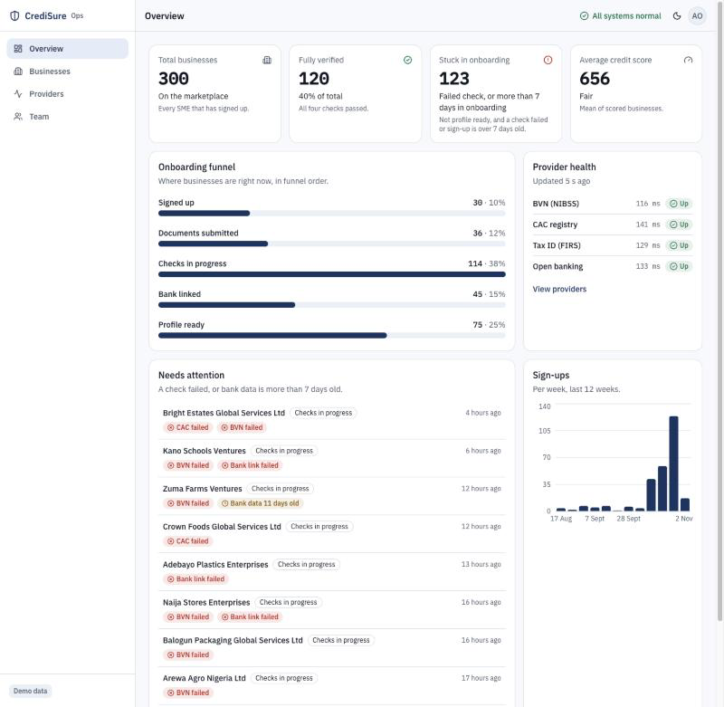
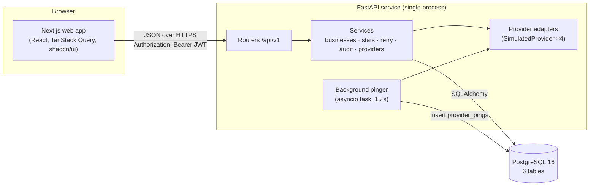

# CrediSure Ops Console

CrediSure's SME marketplace promises faster lending through automated verification, but when onboarding slows, staff can't easily tell whether the applicant or a provider outage is to blame. The Ops Console shows which businesses are stuck in onboarding, why, and whether it's us or a provider. Ops staff can then re-run a failed check safely.

**Live demo:** _to be added after deploy_



All data is seeded and fictional. This is a prototype for an engineering assessment.

## What the assessment asked for → where to find it

| Brief item | Where | How to confirm it |
|---|---|---|
| Login screen | `/login` | Email and password with inline validation, a clear error for wrong credentials, three demo-account buttons, and a "prototype, all data is fictional" label. Missing or expired sessions redirect here |
| Dashboard overview | `/overview` | Four stat cards, the five-stage onboarding funnel, a needs-attention list, a sign-ups chart and a provider health summary |
| User table | `/businesses` and `/team` | **Businesses** are the marketplace users (onboarding applicants): sortable, paginated, with loading, empty and error states and a detail drawer. **Team** is the console's own staff, built from the same table component |
| Search and filter | `/businesses` and `/team` | Server-side search (300 ms debounce) by business name, CAC number or director. Combinable filters for stage, sector, score band and failed check. A result count and Clear all. The state lives in the URL, so a view can be shared |
| API request status indicator | Header and `/providers` | App level: a top progress bar, an error toast with Retry, and a header health dot. Provider level: BVN, CAC, tax ID and open-banking cards with status, latency, uptime, a sparkline and incident history, refreshed every 15 s |
| Responsive navigation | App shell | A sidebar at 1024 px and wider, and a hamburger with a slide-in menu below that. The active page is highlighted, the menu closes after navigating, and the user menu shows the role |

## Quick start

Prerequisite: Docker (with Compose).

```bash
git clone <repo-url> ops-console && cd ops-console
docker compose up --build
```

Then open http://localhost:3000. The first run migrates and seeds the database automatically (300 fictional businesses). The API is at http://localhost:8000 and Postgres is on host port 5433.

The live demo runs on free tiers. The API sleeps after 15 minutes without traffic, so the first request can take about 50 seconds. The header health dot shows "Checking…" and then recovers.

## Demo accounts

| Role | Email | Password | Can do |
|---|---|---|---|
| Ops admin | `admin@credisure.demo` | `Admin@2026` | Everything, including re-running failed checks and the demo-only provider simulate control |
| Credit analyst | `analyst@credisure.demo` | `Analyst@2026` | Read-only: overview, businesses, detail, audit, providers and team |
| Viewer | `viewer@credisure.demo` | `Viewer@2026` | Overview and provider health only. Personal data is hidden |

The login page also has one-click buttons for each account. These accounts exist only in the seeded demo data.

## Five-minute demo script

1. **Why.** Read the first paragraph above: staff need to tell an applicant problem from a provider outage.
2. **Roles.** Sign in as the viewer: only Overview and Providers appear, and there is no personal data. Sign out and sign in as the ops admin.
3. **Overview.** Walk the funnel from "Signed up" to "Profile ready", then click a business in "Needs attention".
4. **Businesses.** Search for a name, then filter to Stage "Checks in progress" plus Failed check "BVN failed". Copy the URL, open it in a new tab and you get the same view.
5. **Drawer.** Open a business with a failed BVN check and read the failure reason. Click **Re-run check** (double-click if you like): only one audit entry is added, thanks to the idempotency key.
6. **Providers.** Open Providers and set BVN to Down. The card shows Down, the red banner says it's a provider problem and not an applicant problem, and the header dot turns amber. Back in a business drawer, re-run a BVN check: "Provider unavailable". Set BVN back to Up.
7. **Responsive.** Shrink the window to phone width: the hamburger menu replaces the sidebar.
8. **Trade-offs.** Close with the decisions below.

## Architecture

A Next.js app talks only to a FastAPI service, which reads and writes PostgreSQL. A background task pings four simulated verification providers every 15 s, and the console shows their status.



Stack: Next.js 15, TypeScript, Tailwind and shadcn/ui in `web/`; FastAPI, SQLAlchemy 2 and Alembic in `api/`; PostgreSQL 16.

- Full design: [docs/system-design.md](docs/system-design.md)
- Decisions: [docs/adr/](docs/adr/)

## API

Base path `/api/v1`, except `GET /health`. Interactive docs are at http://localhost:8000/docs.

| Method and path | viewer | analyst | ops_admin | Purpose |
|---|:-:|:-:|:-:|---|
| `POST /auth/login` | public | public | public | Issue a JWT |
| `GET /auth/me` | ✓ | ✓ | ✓ | Current user |
| `GET /health` | public | public | public | App and database status |
| `GET /stats/overview` | ✓ | ✓ | ✓ | Cards, funnel, needs-attention, sign-ups series |
| `GET /businesses` | ✗ | ✓ | ✓ | Search, filter, sort, paginate |
| `GET /businesses/export.csv` | ✗ | ✓ | ✓ | Same filters, streamed CSV |
| `GET /businesses/{id}` | ✗ | ✓ | ✓ | Detail drawer |
| `GET /businesses/{id}/audit` | ✗ | ✓ | ✓ | Audit timeline |
| `POST /businesses/{id}/checks/{type}/retry` | ✗ | ✗ | ✓ | Idempotent re-run |
| `GET /meta/filters` | ✗ | ✓ | ✓ | Stages, sectors, check types, score bands |
| `GET /providers/status` | ✓ | ✓ | ✓ | Latest status, 24 h uptime and latency, recent pings |
| `GET /providers/{name}/incidents` | ✓ | ✓ | ✓ | Incident history (7 days) |
| `POST /providers/{name}/simulate` | ✗ | ✗ | ✓ | Demo: set a provider up, slow or down |
| `GET /staff` | ✗ | ✓ | ✓ | Team page |

Every error uses `{"error": {"code", "message", "request_id"}}`.

## Development

Prerequisites: Docker, [uv](https://docs.astral.sh/uv/), Node 22 with pnpm.

| Command | What it does |
|---|---|
| `make install` | Install API and web dependencies and the pre-commit hook |
| `make dev` | Full stack in Docker (`docker compose up --build`) |
| `make db` | Start only Postgres (host port 5433) |
| `make migrate` / `make seed` | Apply migrations / seed the demo data (`make seed ARGS=--reset` rebuilds it) |
| `make lint` | ruff, ruff format, mypy (strict on `app/`), ESLint, Prettier |
| `make test` | API tests with pytest against Postgres (`credisure_test`, never SQLite) |
| `make web-check` | `tsc --noEmit` and a production build |
| `make web-test` | Web unit tests (vitest) |

To run outside Docker, start Postgres with `make db`, then:

```bash
cd api && uv run alembic upgrade head && uv run python -m scripts.seed
cd api && uv run uvicorn app.main:app --port 8000      # API
cd web && pnpm dev                                      # web on :3000
```

After changing an API schema, run the API and regenerate the web types with `cd web && pnpm gen:api`. `web/src/lib/api-types.ts` is generated and is never edited by hand.

Deploying: see [docs/deploy.md](docs/deploy.md) (Render for the API and database, Vercel for the web app).

## Decisions and trade-offs

- **Monorepo with `api/` and `web/`** keeps the contract, the tests and the docs in one place (ADR-001).
- **FastAPI, SQLAlchemy 2 and Postgres, also in tests**, so query behaviour such as sorting nulls last matches production (ADR-002).
- **Stateless JWT in `localStorage`, no refresh tokens.** Simple across the Vercel and Render origins. For production use a BFF with httpOnly cookies and refresh rotation (ADR-003).
- **Idempotency keys in a Postgres table.** The key is committed before the provider is called, so a double-click or a second tab can't cause two provider calls (ADR-004). Different keys are different intents: two admins clicking in two tabs both run, and idempotency doesn't serialise them. That is by design, and there are no row locks.
- **In-process pinger and in-memory simulate mode.** One API instance only. With more instances, move to a scheduled worker and store the provider mode in the database (ADR-005).
- **Mask at storage.** Only the last four digits of a BVN or account number are stored, returned or logged (ADR-006).
- **The URL is the source of truth for table state**, so filtered views are shareable and survive refresh (ADR-007).
- **Offset pagination and no caching.** Fine at this scale; revisit past about 100k rows or when overview aggregates slow down.
- **Seeded credit scores** are illustrative. A real score would need its own model.

## What I'd build next

Real provider adapters with circuit breakers; webhooks for bank-data sync instead of polling; alerting when a provider stays down for more than 2 minutes (Slack or PagerDuty); login rate limiting; bulk retry for every business failing on a recovered provider; an SLA timer per onboarding stage.

## Data and privacy

All data is fictional and generated by the seed script. Credit scores are illustrative. BVNs and bank account numbers are stored as their last four digits only, so a full number never reaches the database, the API or the logs.

## AI-assisted workflow

The project was built design-first. A system design and ADRs came first, then one spec per phase (`docs/build/phase-N-*.md`). Each phase was implemented against its spec on its own branch, then reviewed against the spec, the design and an acceptance checklist, with fixes committed on the same branch. The implementation and review reports for every phase are in [docs/build/](docs/build/), starting with [docs/build/README.md](docs/build/README.md).
