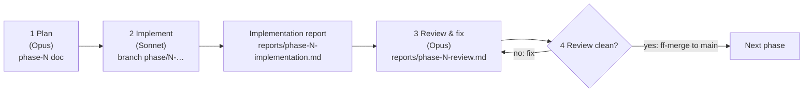

# Build Plan

The approved [system design](../system-design.md) is the source of truth. This folder turns it into seven phases. Each phase is small enough to implement, review and merge in one sitting.

## Workflow



| Step | Who | Input | Output |
|---|---|---|---|
| 1. Plan | Opus | System design + previous review | `docs/build/phase-N-*.md` (this folder) |
| 2. Implement | Sonnet | The phase doc only, plus the design sections it cites | Code on branch `phase/N-<slug>`, commits, and `docs/build/reports/phase-N-implementation.md` |
| 3. Review & fix | Opus | Branch diff, implementation report, phase doc | Fixes committed on the same branch, plus `docs/build/reports/phase-N-review.md` |
| 4. Merge | Opus (the owner has delegated approval) | A clean review | `git merge --ff-only` into `main`, then start the next phase. No pushing |

### Rules for the implementer (Sonnet)
1. Read the phase doc top to bottom first, then the design sections listed under **Read first**.
2. Build **only** what the phase doc lists. If something seems missing or wrong, record it under "Deviations / questions" in the report instead of redesigning. Small, obviously correct choices (a helper name, a CSS value) are fine.
3. Work on branch `phase/N-<slug>` cut from `main`. Make small, logical commits. **Every commit message is one line in Conventional Commits form** (`feat(api): add business list filters`), short and specific. **No body, no `Co-Authored-By` and no AI attribution trailer of any kind.**
4. Run every command under **Verify** and paste the real output into the report. Never claim a check passed without running it.
5. Fill in [templates/implementation-report.md](templates/implementation-report.md) and save it as `reports/phase-N-implementation.md`.
6. Don't merge and don't push. Stop after the report.

### Rules for the reviewer (Opus)
1. Check the diff against the phase doc's acceptance criteria and its **Review checklist**, and against the design (contracts, error codes, roles).
2. Re-run the **Verify** commands yourself.
3. Fix issues directly on the branch, with one commit per fix (`fix(api): …`).
4. Write `reports/phase-N-review.md` from [templates/review.md](templates/review.md), with each finding's severity and the fix commit.
5. When no blocker or major finding remains, `git switch main && git merge --ff-only phase/N-<slug>`.

## Phases

| # | Phase | Doc | Delivers | Depends on |
|---|---|---|---|---|
| 1 | Repo setup & tooling | [phase-1-repo-setup.md](phase-1-repo-setup.md) | Monorepo skeleton, Docker Compose, lint/test tooling, CI | none |
| 2 | Data model & auth | [phase-2-data-auth.md](phase-2-data-auth.md) | 6 tables, migration, seed, error envelope, JWT login, roles | 1 |
| 3 | Core data API | [phase-3-core-api.md](phase-3-core-api.md) | Businesses list/detail, filters, stats, meta, staff, CSV | 2 |
| 4 | Providers, retry, audit | [phase-4-providers-retry-audit.md](phase-4-providers-retry-audit.md) | Simulator, pinger, provider status/incidents, idempotent retry, audit endpoint | 3 |
| 5 | Frontend shell | [phase-5-frontend-shell.md](phase-5-frontend-shell.md) | Login, auth, app shell, responsive nav, status layer, dark mode | 2 (API auth) |
| 6 | Screens | [phase-6-screens.md](phase-6-screens.md) | Overview, Businesses table + filters + drawer, Team table | 3, 4, 5 |
| 7 | Providers page, polish, delivery | [phase-7-polish-delivery.md](phase-7-polish-delivery.md) | Provider Health page, a11y/responsive pass, README, deploy config | 6 |

**Schedule (WAT):** Mon night 1 · Tue 2–4 · Tue night / Wed morning 5–6 · Wed afternoon 7 + deploy · Thu before 11:58 is buffer only.

**Cut order if time runs out (from the PRD):** Could items (dark mode, CSV, chart, incidents) → deployment → audit log → idempotent retry. **Never cut any of the six brief items** (see design §1.5).

## Definition of done (every phase)
- Every acceptance criterion in the phase doc is met.
- `make lint` and `make test` pass, and from Phase 5 on, `make web-check` passes too.
- No secrets committed. `.env.example` is updated whenever a new variable appears.
- The implementation report is written with real command output.
- The review is written, blocker and major findings are fixed, and the branch is fast-forward merged into `main`.

## Folder layout
```
docs/build/
  README.md                  this file
  phase-1-…md … phase-7-…md  phase specs (written by Opus)
  templates/                 report templates
  reports/                   implementation + review reports, one pair per phase
```
