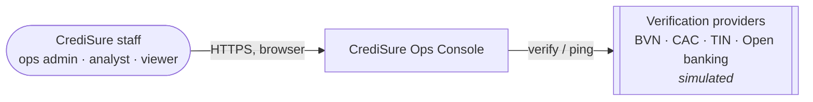
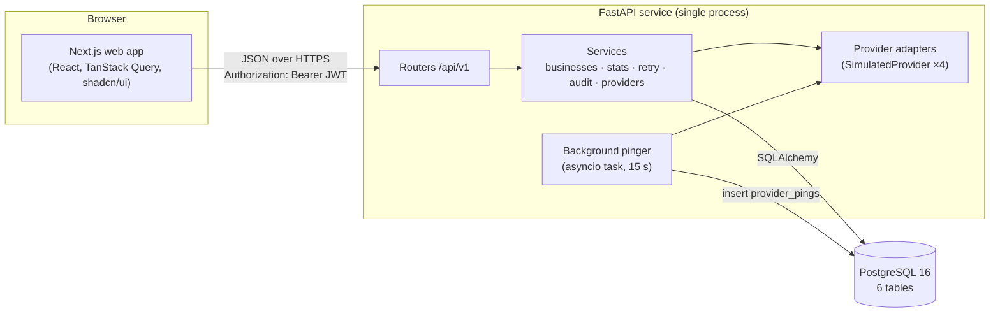
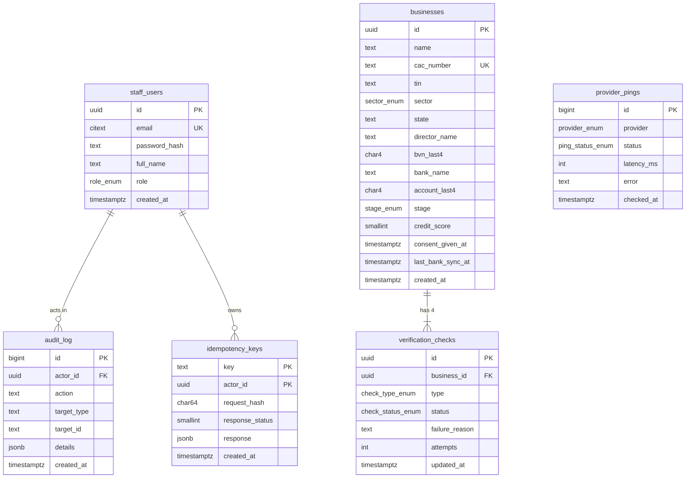
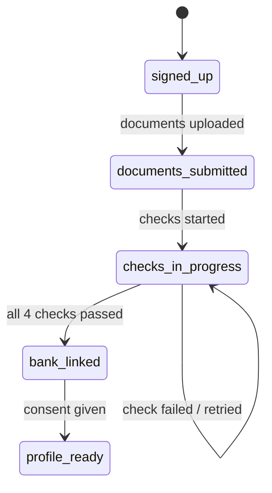
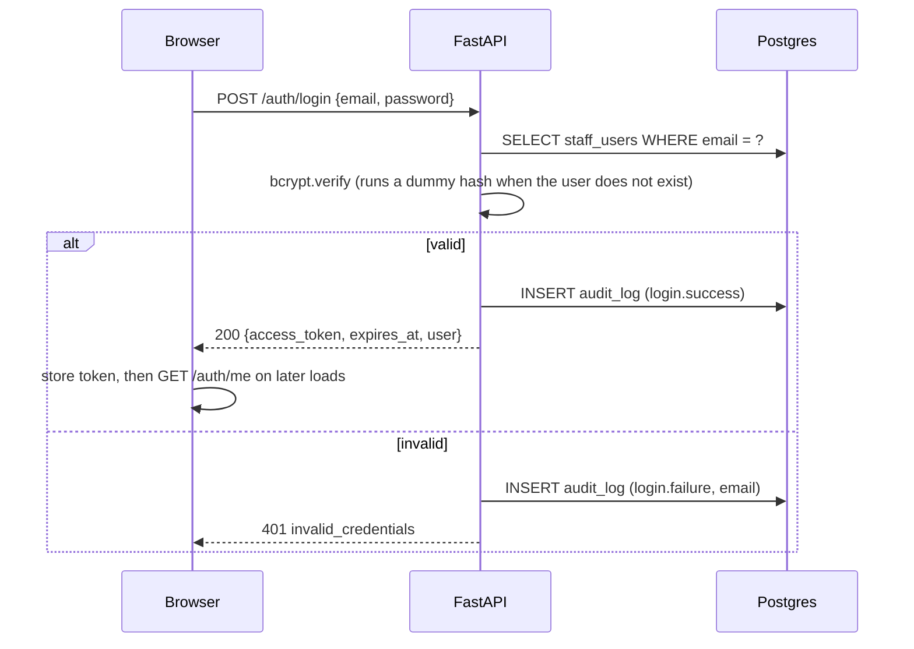
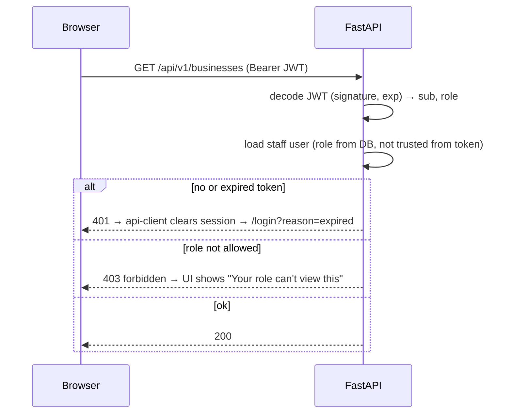
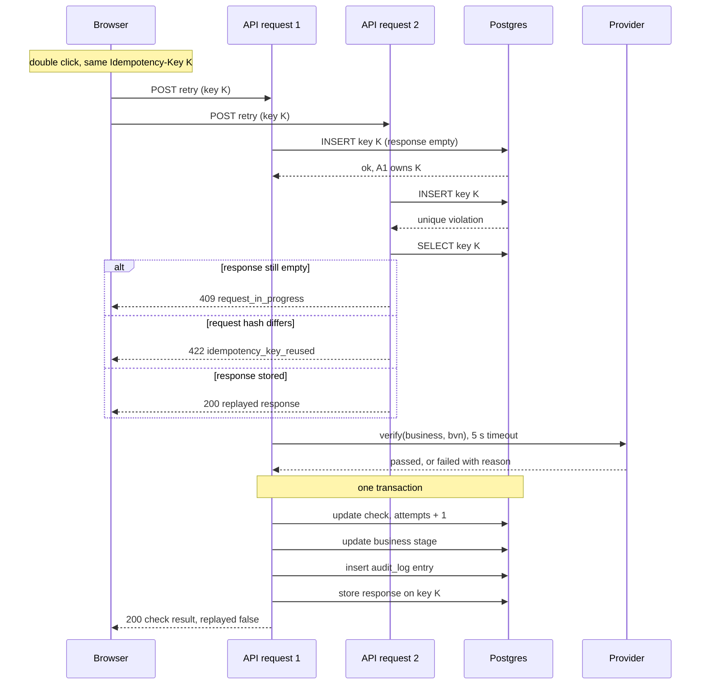
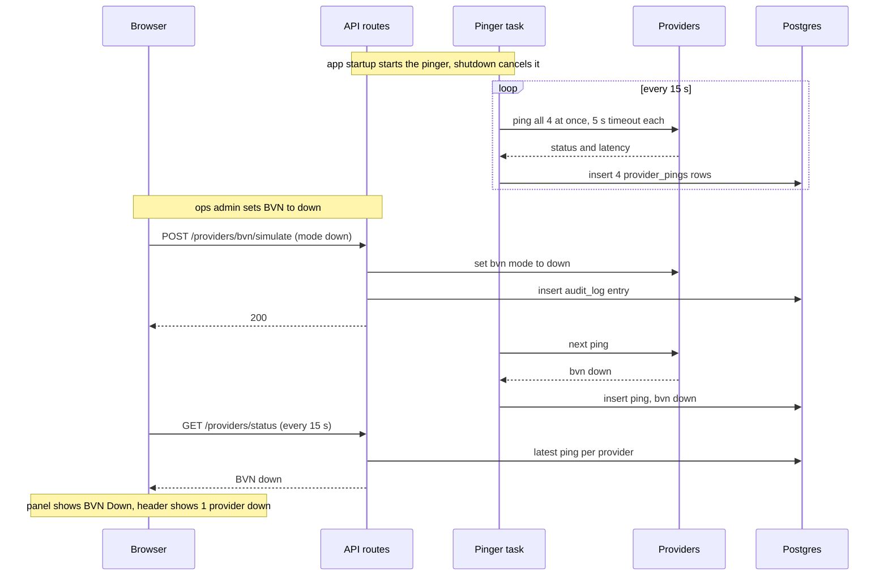

# CrediSure Ops Console: System Design

| | |
|---|---|
| **Status** | Approved, 2 November 2026 |
| **Author** | Chibuikem Collins Obetta |
| **Date** | 2 November 2026 |
| **Source** | CrediSure Ops Console PRD (2 Nov 2026) |
| **Decisions** | [`docs/adr/`](./adr) |

---

## 1. Overview and scope

### 1.1 Problem
CrediSure's SME marketplace promises faster lending through automated verification. Each business passes four external checks before it is loan-ready: CAC registration, tax ID (TIN), the director's BVN, and a linked corporate bank account. Any of these can fail or stall, and when onboarding slows, staff cannot easily tell whether the problem is the applicant or a provider outage.

The **Ops Console** is an internal dashboard where CrediSure staff:
- track every SME from sign-up to profile-ready,
- see which check each business is stuck on and why,
- re-run a failed check safely, and
- watch the health of the third-party verification APIs.

### 1.2 Users and roles

| Role | Who | Can see | Can do |
|---|---|---|---|
| `ops_admin` | Onboarding and operations staff | Everything | Re-run failed checks; toggle simulated provider state (demo) |
| `analyst` | Credit analysts | Overview, businesses, detail, audit, providers, team | Read only |
| `viewer` | Founders, management | Overview and provider health only; personal data hidden | Read only |

### 1.3 Goals and non-goals
**Goals**
- An ops admin can find every business stuck at a given check in under 10 seconds.
- Staff can tell a provider outage from an applicant problem without asking an engineer.
- All six assessment brief items are clearly visible, with real backend depth: authentication, role checks, server-side querying, idempotency, and auditing.

**Non-goals**
- Real BVN, CAC, FIRS or open-banking integrations. These are simulated behind an adapter interface.
- A real credit scoring model. Scores are seeded values on a 300–850 scale.
- Screens for SMEs or lenders, and any money movement.

### 1.4 Requirements traceability

| PRD item | Component(s) | Endpoint(s) |
|---|---|---|
| M1 Login and roles | `core/security`, `routers/auth`, `features/auth` | `POST /auth/login`, `GET /auth/me` |
| M2 Dashboard overview | `services/stats`, `features/overview` | `GET /stats/overview` |
| M3 Businesses table | `services/businesses`, `features/businesses` | `GET /businesses` |
| M4 Search and filter | `services/businesses` (query builder), URL state | `GET /businesses?…`, `GET /meta/filters` |
| M5 API status indicator | `routers/health`, `providers/*`, status layer | `GET /health`, `GET /providers/status` |
| M6 Responsive navigation | `components/layout` | n/a |
| M7 Detail drawer | `features/businesses/drawer` | `GET /businesses/{id}` |
| S1 Re-run failed check | `services/retry`, `idempotency_keys` | `POST /businesses/{id}/checks/{type}/retry` |
| S2 Audit log | `services/audit`, `audit_log` | `GET /businesses/{id}/audit` |
| S3 Tests | `api/tests` | n/a |
| S4 Delivery | Docker Compose, CI, hosting | n/a |
| Could: CSV export | `services/businesses` | `GET /businesses/export.csv` |
| Could: sign-ups chart | `services/stats` | `GET /stats/overview` (`signups`) |
| Could: incident history | `services/providers` | `GET /providers/{name}/incidents` |
| Could: dark mode | `next-themes` | n/a |
| Risk mitigation: "user table" | `features/staff` | `GET /staff` |

### 1.5 Assessment brief coverage
The brief asks for "a simple dashboard interface". Each of its six items is listed below with where it appears and how a reviewer can confirm it.

| Brief item (verbatim) | Where it lives | How a reviewer sees it |
|---|---|---|
| Login screen | `/login` | Email and password form with inline validation, a clear error for wrong credentials, three demo-account buttons, and the "Prototype… all data is fictional" label. Missing or expired sessions redirect here |
| Dashboard overview | `/overview` | 4 stat cards (total, fully verified, stuck, average score), the 5-stage onboarding funnel, the needs-attention list, the sign-ups chart, and a provider health summary |
| User table | `/businesses` (primary) and `/team` | **Businesses**: the onboarding applicants, the users of CrediSure's marketplace. Sortable, paginated, with loading, empty and error states and a detail drawer. **Team**: the console's own staff users (name, email, role, joined), built from the same table component, so the literal reading of "user table" is covered too |
| Search and filter functionality | `/businesses` (and `/team`) | Server-side search by business name, CAC number or director, with a 300 ms debounce. Filters for stage, sector, score band and failed check, combinable, with a result count and Clear all. The state is kept in the URL. Team gets search plus a role filter |
| API request status indicator | Header and `/providers` | **App level**: a top progress bar on every request, an error toast with Retry, and a header dot polling `/health`. **Provider level**: the BVN, CAC, TIN and open-banking panel showing up, slow or down, latency and last checked time, refreshed every 15 s |
| Responsive navigation | App shell | A sidebar at ≥1024 px, and a hamburger with a slide-in menu below that. Active page highlighted, the menu closes after navigating, it works with the keyboard, and the user menu shows the role |

Everything beyond these six items (roles, check retry, audit, provider simulation, tests, Docker, dark mode, CSV) is backend depth and polish. It must never delay any of the six.

---

## 2. Requirements

### 2.1 Functional
These follow PRD §5 (M1–M7, S1–S4, Could). The behaviours that need a precise definition are set out here because both the API and the UI depend on them:

| Term | Definition |
|---|---|
| **Fully verified** | All four checks have status `passed`. |
| **Stuck in onboarding** | Stage ≠ `profile_ready` **and** (any check `failed` **or** signed up more than 7 days ago). |
| **Needs attention** | Any check `failed`, **or** the bank link passed and `last_bank_sync_at` is more than 7 days old (stale bank data). |
| **Score bands** | Poor 300–579 · Fair 580–669 · Good 670–739 · Very good 740–799 · Excellent 800–850. The UI maps bands to `score_min`/`score_max`. |

### 2.2 Non-functional

| Concern | Target |
|---|---|
| **Latency** | p95 under 200 ms for every read endpoint at the seeded size (~300 businesses). Designed to stay under 300 ms at 100k businesses through indexes and trigram search (§5.4). |
| **Provider calls** | 5 s timeout per call. Provider latency never blocks read endpoints. |
| **Availability** | Single-instance deployment is acceptable for an internal tool. `/health` reports database reachability. |
| **Security** | bcrypt passwords, short-lived JWT, role checks on every request, no full BVN or account number stored anywhere. |
| **Privacy** | Data minimisation in line with the Nigeria Data Protection Act. All data is fictional. |
| **Usability** | Loading skeletons, empty and error states. Keyboard navigable. WCAG AA contrast in light and dark themes. |
| **Responsiveness** | Sidebar at ≥1024 px, slide-in menu below. Usable at 375 px. |
| **Operability** | One command local setup (`docker compose up`). CI on every push. |

### 2.3 Constraints and assumptions
- About three evenings of build time, so complexity is spent only where the brief rewards it.
- Free hosting tiers (cold starts, one instance), which shapes ADR-005.
- Staff count stays in the tens, so read traffic is low and there are no caching layers.
- All times are stored in UTC (`timestamptz`) and displayed in `Africa/Lagos`.

---

## 3. High-level architecture

### 3.1 Context (C4 level 1)



### 3.2 Containers (C4 level 2)



- The browser only ever talks to the FastAPI service. There is no server-side rendering of protected data (see ADR-003).
- Providers sit behind an adapter interface. Replacing `SimulatedProvider` with a real HTTP adapter changes one module and nothing in the routers or the UI.
- **Trust boundaries:** (1) browser ↔ API, where every request is authenticated and authorised; (2) API ↔ providers, where all responses are treated as untrusted, calls have a timeout, and errors are mapped to domain failures.

---

## 4. Component design

### 4.1 Backend layout (`api/`)

```
app/
  main.py               app factory, middleware (CORS, request-id, logging), lifespan → starts pinger
  core/
    config.py           pydantic-settings: DATABASE_URL, JWT_SECRET, JWT_TTL_MIN, CORS_ORIGINS, PINGER_ENABLED
    security.py         bcrypt, JWT encode/decode, get_current_user, require_roles(*roles)
    errors.py           AppError hierarchy + exception handlers → error envelope
    logging.py          JSON structured logs
  db/
    base.py, session.py SQLAlchemy 2.0 engine + session dependency
  models/               ORM models (one file per table)
  schemas/              Pydantic v2 request/response models
  services/
    businesses.py       query builder shared by list + CSV export; detail
    stats.py            overview aggregates
    retry.py            idempotent check retry (§7.3)
    audit.py            write_audit(), list_for_business()
    providers.py        status, uptime, incident grouping
    stage.py            pure function: derive_stage(checks, consent) (§5.3)
  providers/
    base.py             VerificationProvider protocol, PingResult, CheckResult
    simulator.py        SimulatedProvider with mode {up, slow, down}
    registry.py         name → provider instance
    pinger.py           background loop
  api/v1/routers/       auth, health, stats, businesses, providers, meta, staff
alembic/                migrations
scripts/seed.py         idempotent seed (skips if data exists)
tests/
```

**Layering:** routers handle HTTP concerns only (parsing, status codes, dependencies). Services hold the business rules and SQLAlchemy queries. Models are plain ORM classes. A separate repository layer is left out on purpose: with six tables it would add indirection without adding testability, because services are tested against a real Postgres anyway (§10).

**Provider adapter interface**
```python
class VerificationProvider(Protocol):
    name: ProviderName                      # bvn | cac | tin | open_banking
    async def ping(self) -> PingResult: ...           # status, latency_ms, error
    async def verify(self, business: Business, check: CheckType) -> CheckResult: ...  # passed | failed + reason
```
Check-to-provider mapping: `cac → cac`, `tin → tin`, `bvn → bvn`, `bank_link → open_banking`.

### 4.2 Frontend layout (`web/`)

```
src/
  app/
    (auth)/login/page.tsx
    (console)/layout.tsx            auth guard, AppShell (sidebar / mobile sheet, header)
    (console)/overview/page.tsx
    (console)/businesses/page.tsx   table; ?id= opens the detail drawer
    (console)/providers/page.tsx
    (console)/team/page.tsx
  features/
    auth/        AuthProvider, useAuth, LoginForm
    overview/    StatCards, Funnel, NeedsAttention, SignupsChart
    businesses/  FilterBar, BusinessesTable, CheckBadge, BusinessDrawer, useBusinessFilters (URL state)
    providers/   ProviderHealthPanel, IncidentList, SimulateToggle
    staff/       StaffTable
  components/
    ui/          shadcn/ui primitives
    layout/      AppSidebar, MobileNav, Header, HealthDot, UserMenu, TopProgressBar, RoleGate
  lib/
    api-client.ts    fetch wrapper: base URL, bearer token, error envelope → ApiError, 401 → logout
    query-client.ts  TanStack Query defaults + global onError → toast with Retry
    api-types.ts     generated from the FastAPI OpenAPI schema (openapi-typescript)
    format.ts        dates (Africa/Lagos), naira, relative time
```

**State strategy**

| State | Lives in | Why |
|---|---|---|
| Server data (businesses, stats, providers) | TanStack Query cache | Caching, refetch intervals, retries, and `useIsFetching` for the progress bar |
| Filters, sort, page, open drawer | URL search params | Shareable, survives refresh, back button works (ADR-007) |
| Session (token, user) | `AuthProvider` + `localStorage` | Survives reloads (ADR-003) |
| Theme | `next-themes` | Standard approach, no flash on load |

**Typed contract:** `api-types.ts` is generated from `/openapi.json`, so the frontend types cannot drift from the Pydantic schemas. CI regenerates the file and fails if the diff is not empty.

---

## 5. Data model

### 5.1 ERD



### 5.2 Enums
- `role`: `ops_admin | analyst | viewer`
- `stage`: `signed_up | documents_submitted | checks_in_progress | bank_linked | profile_ready`
- `check_type`: `cac | tin | bvn | bank_link`
- `check_status`: `pending | passed | failed`
- `provider`: `bvn | cac | tin | open_banking`
- `ping_status`: `up | slow | down` (slow means it succeeded with latency of 1,000 ms or more)

### 5.3 Onboarding stage machine



- `signed_up` and `documents_submitted` are set by the applicant-facing app, which is out of scope here. The seed produces them, and the console never moves a business back into them.
- From `checks_in_progress` onward, the stage is **derived** by the pure function `derive_stage(checks, consent_given_at)` after every check update. The stored column is a denormalised copy for fast filtering and the funnel, and the function is the single source of truth. It is unit-tested exhaustively.

### 5.4 Constraints and indexes

| Table | Constraint / index | Reason |
|---|---|---|
| `staff_users` | `UNIQUE(email)` (citext) | Login lookup, case-insensitive |
| `businesses` | `UNIQUE(cac_number)` | Natural key, exact CAC search |
| | B-tree on `stage`, `sector`, `credit_score`, `created_at`, `last_bank_sync_at` | Filters and sort columns |
| | GIN `pg_trgm` on `name`, `director_name` | `ILIKE '%term%'` search stays indexed as data grows |
| `verification_checks` | `UNIQUE(business_id, type)` | Exactly one row per check type |
| | Partial index on `(type) WHERE status = 'failed'` | Fast "has failed check" filter |
| `provider_pings` | `(provider, checked_at DESC)` | Latest ping per provider, 24 h window |
| `audit_log` | `(target_type, target_id, created_at DESC)` | Detail drawer timeline |
| `idempotency_keys` | `PRIMARY KEY(key, actor_id)` | Keys are scoped per user, and the race guard lives here (§7.3) |

**Masking at storage (ADR-006):** only `bvn_last4` and `account_last4` exist. The full identifiers are never written, so no endpoint, log line or backup can leak them.

**Retention:** the pinger deletes `provider_pings` older than 7 days (about 23k rows/day). Idempotency keys older than 24 h are purged on the same loop.

---

## 6. API contract

The base path is `/api/v1`, except `GET /health`, which stays unversioned for infrastructure probes. The interactive OpenAPI docs are at `/docs`.

### 6.1 Endpoints and role matrix

| Method & path | viewer | analyst | ops_admin | Purpose |
|---|:-:|:-:|:-:|---|
| `POST /auth/login` | public | public | public | Issue JWT |
| `GET /auth/me` | ✓ | ✓ | ✓ | Current user |
| `GET /health` | public | public | public | App + DB status |
| `GET /stats/overview` | ✓ | ✓ | ✓ | Cards, funnel, needs-attention, sign-ups series |
| `GET /businesses` | ✗ | ✓ | ✓ | Search / filter / sort / paginate |
| `GET /businesses/export.csv` | ✗ | ✓ | ✓ | Same filters, streamed CSV |
| `GET /businesses/{id}` | ✗ | ✓ | ✓ | Detail drawer |
| `GET /businesses/{id}/audit` | ✗ | ✓ | ✓ | Audit timeline |
| `POST /businesses/{id}/checks/{type}/retry` | ✗ | ✗ | ✓ | Idempotent re-run |
| `GET /meta/filters` | ✗ | ✓ | ✓ | Stages, sectors, check types, score bands |
| `GET /providers/status` | ✓ | ✓ | ✓ | Latest status, simulated mode, 24 h uptime and latency, last 40 pings for the sparkline |
| `GET /providers/{name}/incidents` | ✓ | ✓ | ✓ | Incident history (7 days) |
| `POST /providers/{name}/simulate` | ✗ | ✗ | ✓ | Demo: set up / slow / down |
| `GET /staff` | ✗ | ✓ | ✓ | Team page: `search` (name or email), `role`, `sort`, `page`, `page_size` |

### 6.2 List semantics: `GET /businesses`

| Param | Type | Behaviour |
|---|---|---|
| `search` | string, ≤100 chars | Trimmed. Case-insensitive substring on name and director name, prefix match on CAC number |
| `stage` | enum, repeatable | OR within the parameter |
| `sector` | enum, repeatable | OR within the parameter |
| `score_min`, `score_max` | int 300–850 | Inclusive. 422 if min > max |
| `failed_check` | `any \| cac \| tin \| bvn \| bank_link` | `EXISTS` on a failed check |
| `sort` | `name \| credit_score \| created_at \| last_bank_sync_at` | Allow-listed. Default `created_at` |
| `order` | `asc \| desc` | Default `desc` |
| `page`, `page_size` | int ≥1, 1–100 | Default 1, 20 |

All filters combine with AND. Sorting always appends `id` as a tie-breaker so pages stay stable. Offset pagination is used because the UI shows numbered pages (keyset pagination is listed as future work).

```json
{
  "items": [{
    "id": "4f6c…", "name": "Adebayo Agro Ventures Ltd", "sector": "agriculture",
    "state": "Oyo", "stage": "checks_in_progress", "credit_score": 642,
    "checks": {"cac": "passed", "tin": "passed", "bvn": "failed", "bank_link": "pending"},
    "last_bank_sync_at": null, "created_at": "2026-10-21T09:14:00Z"
  }],
  "total": 37, "page": 1, "page_size": 20
}
```
The check statuses for the whole page come from one batched query (`WHERE business_id IN (:page_ids)`), not one query per row. That makes three queries per list request (count, page, checks), whatever the page size.

### 6.3 Detail: `GET /businesses/{id}`
Returns the list item fields plus `cac_number`, `tin`, `director_name`, `bvn_masked: "*******1234"`, `bank_name`, `account_masked: "******5678"`, `consent_given_at`, and `checks: [{type, status, failure_reason, attempts, updated_at}]`.

### 6.4 Retry: `POST /businesses/{id}/checks/{type}/retry`
- **Header:** `Idempotency-Key: <uuid>` (required)
- **Body:** none
- **200:** `{"check": {type, status, failure_reason, attempts, updated_at}, "business_stage": "...", "replayed": false}`. On replay, the stored body is returned with `"replayed": true` and the response header `Idempotent-Replayed: true`.
- If the provider is down, the API still returns **200**: the attempt happened and its outcome was `failed` with `failure_reason: "Provider unavailable (bvn)"`. A provider outage is a business outcome here, not a server error.

### 6.5 Error envelope
Every non-2xx response has this shape:
```json
{"error": {"code": "forbidden", "message": "Your role (analyst) cannot re-run checks.", "request_id": "b1f…"}}
```

| HTTP | `code` | When |
|---|---|---|
| 400 | `idempotency_key_required` | Retry without the header |
| 401 | `invalid_credentials` | Wrong email or password (one generic message for both) |
| 401 | `not_authenticated` | Missing or malformed token |
| 401 | `token_expired` | JWT past `exp`. The UI redirects to login with a "session expired" note |
| 403 | `forbidden` | Role not allowed. The message names the role and the action |
| 404 | `not_found` | Unknown business, check type or provider |
| 409 | `check_not_retryable` | The check is not in `failed` status |
| 409 | `request_in_progress` | Same idempotency key is still being processed |
| 422 | `validation_error` | Pydantic validation. `details` lists the fields |
| 422 | `idempotency_key_reused` | Same key with a different request |
| 500 | `internal_error` | Unhandled. Logged with `request_id`, no internals leaked |

---

## 7. Key flows

### 7.1 Login


Running a dummy hash for unknown emails keeps the response time the same, so attackers can't tell which emails exist.

### 7.2 Protected request and role check


The role is read from the database on each request, so a role change or deactivation takes effect immediately instead of waiting for the token to expire.

### 7.3 Idempotent check retry (with a double-click race)



- The key row is inserted and committed **before** the provider call. The primary key on `(key, actor_id)` is the lock, so two concurrent requests can never both reach the provider.
- `request_hash = sha256(method + path + actor_id)`. Reusing a key for a different business or check gives 422.
- If the provider call raises an unexpected error (not a domain failure), the key row is deleted so that the same key can be retried.
- The client creates one UUID per *click intent*, and the button is disabled while the mutation is pending. The server-side guard covers what the UI cannot, such as two tabs, a network retry, or a fast double click before the re-render.
- Retries are allowed only for checks in `failed` status (409 otherwise).

### 7.4 Provider pinger and simulate toggle



Simulator behaviour per mode:

| Mode | Ping latency | `verify()` |
|---|---|---|
| `up` | 80–250 ms | passes about 80% of the time; otherwise a realistic failure such as "BVN name does not match director", "CAC number not found", "TIN not registered with FIRS", or "Account name mismatch" |
| `slow` | 1.2–2.5 s | same pass/fail rates, just slow |
| `down` | error after 300 ms | always fails with `Provider unavailable (<name>)` |

Simulate mode is held in process memory, which is fine for a single-instance deployment (ADR-005). A restart resets every provider to `up`.

### 7.5 Frontend status layer
- **Progress bar:** visible while `useIsFetching() + useIsMutating() > 0`. It is delayed by 150 ms so fast requests don't flicker.
- **Error toast:** the QueryCache and MutationCache `onError` show a sonner toast with the envelope `message` and a **Retry** action that calls `query.refetch()` or replays the mutation. 401 and 403 errors are handled by the auth flow and role gate, not by toasts.
- **Health dot:** polls `GET /health` every 30 s. Green means the API and database are ok, amber means some provider is degraded, and red means the API is unreachable or the database is down. The tooltip shows when it was last checked.

---

## 8. Security and privacy

| Area | Approach |
|---|---|
| Passwords | bcrypt (cost 12). The seed generates hashes, and demo passwords are only in the README |
| Tokens | HS256 JWT with `sub`, `role`, `exp` (60 min) and `jti`. No refresh token: users sign in again after an hour (ADR-003) |
| Token storage | `localStorage` + `Authorization` header. Mitigated by React escaping, no `dangerouslySetInnerHTML`, a strict CSP on the web host, and a short TTL |
| Authorisation | The `require_roles()` dependency runs on every protected route. Frontend role gates only hide UI; the API is the authority |
| PII | Last-4 digits only for BVN and account (ADR-006). Viewers never receive director names or identifiers. Logs never include request bodies |
| Audit | `audit_log` is append-only: no update or delete routes, and the app's DB role gets `INSERT, SELECT` only on that table in production |
| Input | Pydantic validation, allow-listed sort columns, parameterised SQL only, and `search` length capped |
| Transport | HTTPS on the hosts. CORS allow-list set to the web origin only |
| Abuse | Login rate limiting is listed as future work (`slowapi`, 5 attempts/min per IP). Failed logins are audited today |
| NDPA alignment | Data minimisation, purpose limitation (internal ops only), role-based access, an audit trail of staff actions, and recorded consent status per business |

---

## 9. Observability and reliability
- **Structured logs:** JSON lines with `request_id` (taken from an incoming `X-Request-ID` header or generated), method, path, status, duration and actor id. The `request_id` also appears in error envelopes so a user report can be traced.
- **Health:** `GET /health` returns `{"status": "ok" | "degraded" | "down", "db": "ok" | "down", "providers": {"up", "slow", "down"}, "version", "time"}`. `degraded` (still HTTP 200) means a provider's latest ping is slow or down. `down` with HTTP 503 means the database is unreachable.
- **Provider degradation** is first-class data: the `provider_pings` history drives the status panel, 24 h uptime, and incident grouping (runs of consecutive non-`up` pings).
- **Timeouts** on every provider call (5 s), and the pinger catches each provider separately so one hanging provider can't stall the others.
- **Graceful shutdown:** the lifespan cancels the pinger task and closes the DB engine.

---

## 10. Testing strategy

| Layer | Tooling | Covers |
|---|---|---|
| Unit | pytest | `derive_stage` (every combination of check states), score band mapping, request hashing, incident grouping |
| API / integration | pytest + httpx `TestClient` against **Postgres** (one transaction per test, rolled back) | Login ok, bad password and validation; missing and expired token; role matrix (viewer 403, analyst 403 on retry); filter combinations, sort, and pagination totals; the stats definitions in §2.1; retry: missing key, replay, key reused with a different request, concurrent same-key requests (asyncio), audit row written, provider down |
| Frontend static | ESLint, `tsc --noEmit`, `next build` | Type safety against the generated API types |
| E2E (manual, scripted) | Demo script in the README | The 8-step PRD walkthrough on `docker compose up` |

Tests run against Postgres rather than SQLite because the behaviour that matters (trigram search, `ILIKE`, unique-violation races, `jsonb`) is specific to Postgres. CI uses a Postgres service container (ADR-002).

---

## 11. Deployment and environments

| Env | Web | API | DB |
|---|---|---|---|
| Local | `docker compose up` → `web:3000` | `api:8000` | `postgres:16` with a volume |
| CI | build only | pytest | Postgres service container |
| Demo (live) | Vercel | Render (Docker, 1 instance) | Render Postgres (or Railway) |

- **Configuration:** 12-factor environment variables. `.env.example` is committed and secrets live in the host dashboards. Web needs `NEXT_PUBLIC_API_URL`. API needs `DATABASE_URL`, `JWT_SECRET`, `CORS_ORIGINS` and `ENV`.
- **Startup:** `alembic upgrade head`, then `python -m scripts.seed` (skips if staff already exist), then `uvicorn` with **1 worker** (ADR-005).
- **Cold starts:** free tiers sleep. The README warns about this, and the health dot shows the waking state instead of failing silently.

---

## 12. Risks, trade-offs and future work

| Trade-off taken | Why it's acceptable now | Revisit when |
|---|---|---|
| In-process pinger and in-memory simulate mode | Single instance, demo scale | More than one API instance: move to a scheduled worker and store provider mode in the DB |
| JWT in `localStorage`, no refresh | Cross-site hosts, three evenings of build time | Production: a BFF with httpOnly SameSite cookies and refresh rotation |
| Offset pagination | Numbered pages UI, small data | More than 100k rows or deep paging: keyset pagination |
| No caching | Tiny read load | Overview aggregates slow down: a materialised view or cache with a short TTL |
| Seeded credit scores | Explicit non-goal | A real scoring service with its own model card |

**What I would build next:** real provider adapters with circuit breakers; webhooks for bank-data sync instead of polling; alerting when a provider stays `down` for more than 2 minutes (Slack or PagerDuty); login rate limiting; bulk retry for every business failing on a recovered provider; an SLA timer per onboarding stage.

---

## Appendix: Architecture Decision Records

| ADR | Decision |
|---|---|
| [001](./adr/001-monorepo.md) | Monorepo with `api/` and `web/` |
| [002](./adr/002-fastapi-sqlalchemy-postgres.md) | FastAPI + SQLAlchemy 2 + Alembic on Postgres, Postgres in tests too |
| [003](./adr/003-jwt-bearer-auth.md) | JWT bearer tokens in client storage |
| [004](./adr/004-idempotency-table.md) | Idempotency keys in a Postgres table, not Redis |
| [005](./adr/005-in-process-pinger.md) | In-process asyncio pinger, single API instance |
| [006](./adr/006-mask-at-storage.md) | Store only the last 4 digits of BVN and account numbers |
| [007](./adr/007-url-filter-state.md) | URL as the source of truth for table state |

Each record captures one decision, the options that lost, and when to revisit it. The files in `docs/adr/` are the canonical copies; this appendix mirrors them so the whole design reads in one place. If they ever differ, update the ADR file first.

### ADR-001: Monorepo with `api/` and `web/`

- **Status:** Accepted
- **Date:** 2026-11-02

#### Context
The console has one FastAPI service and one Next.js app, built and reviewed together by one person on a three-day deadline. Reviewers need one link and one command.

#### Decision
A single Git repository with `api/`, `web/`, `docs/`, a root `docker-compose.yml`, a `Makefile`, and one CI workflow with a separate job per app.

#### Alternatives considered
- **Two repositories:** a cleaner separation of ownership, but two links, two CI setups, and the API contract and the UI could change out of step.
- **Turborepo or Nx workspace:** built for many JS packages; adds tooling with no benefit when one side is Python.

#### Consequences
- An API change and the UI change that uses it can land in one commit, and generated API types stay in step with the backend.
- CI path filters keep each job focused. If the apps get separate teams later, `git subtree split` can separate them.

### ADR-002: FastAPI + SQLAlchemy 2 + Alembic on PostgreSQL (also in tests)

- **Status:** Accepted
- **Date:** 2026-11-02

#### Context
The PRD asks for a FastAPI backend and PostgreSQL, with "SQLite locally". The backend needs typed request validation, generated OpenAPI documentation, async support for provider calls, and versioned schema migrations.

#### Decision
- FastAPI with Pydantic v2 for routing, validation and OpenAPI.
- SQLAlchemy 2.0 (typed `Mapped[]` models) with Alembic migrations.
- **PostgreSQL 16 everywhere: local (Docker Compose), CI and production.** This replaces the PRD's "SQLite locally".

#### Alternatives considered
- **SQLite for local development and tests:** zero setup, but trigram indexes, `ILIKE`, `jsonb`, `citext`, enum types, and unique-violation behaviour under concurrency all differ. The idempotency race test would pass on SQLite and say nothing about production.
- **SQLModel:** less boilerplate, but it lags SQLAlchemy 2 features and mixes API schemas with persistence models.
- **Raw SQL / asyncpg:** fastest, but no migrations or model layer for little gain at this scale.

#### Consequences
- Docker becomes the one local prerequisite. `docker compose up db` is enough for running tests.
- The tests exercise the real database behaviour that the design depends on.

### ADR-003: Stateless JWT bearer tokens stored client-side

- **Status:** Accepted
- **Date:** 2026-11-02

#### Context
The web app (Vercel) and the API (Render) are on different origins. The PRD specifies that `POST /auth/login` returns a JWT and that the browser talks only to FastAPI.

#### Decision
- HS256 JWT (`sub`, `role`, `exp` = 60 min, `jti`), sent as `Authorization: Bearer`.
- Stored in `localStorage` so a page reload keeps the session. No refresh token: after an hour the user signs in again.
- The role is loaded from the database on every request; the role claim in the token is informational only.
- Protected pages render client-side behind an auth guard.

#### Alternatives considered
- **httpOnly cookie set by the API:** cross-site cookies need `SameSite=None; Secure` plus CSRF protection, and are increasingly blocked by browsers.
- **Backend-for-frontend (Next.js route handlers proxy to FastAPI, httpOnly same-site cookie):** the most secure option, but it breaks the PRD's "browser only talks to FastAPI" design and adds a proxy hop and more code.
- **Server-side sessions:** needs a session store; no benefit over a short-lived JWT here.

#### Consequences
- Simple and stateless. Easy to test with curl and Swagger.
- Exposed to token theft if an XSS bug exists. Mitigated by React escaping, a CSP, the short TTL, and role re-checks against the database. The documented upgrade path is the BFF + httpOnly cookie option.
- Tokens cannot be revoked before expiry. Acceptable at 60 minutes, and deactivation still takes effect immediately because the user is reloaded on every request.

### ADR-004: Idempotency keys stored in a Postgres table

- **Status:** Accepted
- **Date:** 2026-11-02

#### Context
Re-running a check calls an external provider, which may be billed per call and has side effects. A double click, two tabs, or a client network retry must never cause two provider calls (PRD S1).

#### Decision
- The client sends `Idempotency-Key: <uuid>`. The server keeps the `idempotency_keys(key, actor_id)` primary key with `request_hash`, `response_status`, `response` and `created_at`.
- The key row is **inserted and committed before** the provider call. A concurrent duplicate hits the primary key and either replays the stored response, gets `409 request_in_progress`, or gets `422 idempotency_key_reused`.
- The check update, the stage update, the audit entry, and the stored response are written in one transaction. Keys expire after 24 h.

#### Alternatives considered
- **Redis `SET NX` with a TTL:** the standard choice at scale, but it is another piece of infrastructure, and the guard would not be in the same transaction as the check update.
- **Row lock on the check (`SELECT … FOR UPDATE`):** serialises concurrent retries but cannot replay the first response, so the client cannot tell "already done" from "done now".
- **Frontend debouncing only:** does not protect against two tabs, client retries, or API clients.

#### Consequences
- Correct under concurrency, uses the existing database, and is testable in pytest.
- One extra write per retry, which is negligible at this volume.

### ADR-005: In-process asyncio pinger and a single API instance

- **Status:** Accepted
- **Date:** 2026-11-02

#### Context
Provider health must be sampled every 15 s and stored for the status panel, uptime, and incident history. Hosting is a free tier with one instance.

#### Decision
- An asyncio task started in the FastAPI lifespan pings the 4 providers concurrently every 15 s and writes to `provider_pings`.
- The simulated provider mode (up, slow or down) is held in process memory.
- The API runs **one uvicorn worker** and one instance.

#### Alternatives considered
- **Separate worker (Celery/RQ, or an arq job), or a cron job:** correct for multiple instances, but needs a broker and a second deployable.
- **Postgres advisory lock to elect one pinger across workers:** a good middle step, but provider mode would still need to move to the database. Deferred.
- **Ping on demand when the status endpoint is called:** no history, so no uptime or incidents, and it slows the request.

#### Consequences
- No extra infrastructure, and replacing simulated providers with real adapters only touches `providers/`.
- Scaling out would duplicate pings and split the simulate state. Revisit with an advisory lock plus a `provider_settings` table, or a dedicated worker, before running more than one instance.

### ADR-006: Store only the last four digits of BVN and account numbers

- **Status:** Accepted
- **Date:** 2026-11-02

#### Context
Staff need to recognise a director's BVN or a bank account during support, but nobody in operations needs the full number. The Nigeria Data Protection Act expects data minimisation.

#### Decision
`businesses` stores `bvn_last4` and `account_last4` only. The API returns them masked (`*******1234`). Full identifiers are never accepted, stored or logged by this service.

#### Alternatives considered
- **Store the full value and mask in the API serializer:** one forgotten serializer or debug log leaks it.
- **Encrypt the full value at rest:** needed only when something must use the full number. Here verification is the provider's job.

#### Consequences
- Leaking the data through this service's database, backups or logs is impossible by construction.
- If a future feature needs the full number, it must come from a separate, access-controlled vault with its own ADR.

### ADR-007: The URL is the source of truth for table state

- **Status:** Accepted
- **Date:** 2026-11-02

#### Context
PRD M4 requires a filtered view to survive a refresh and to be shareable. The detail drawer should also be linkable from the needs-attention list.

#### Decision
`search`, `stage`, `sector`, `score_min`/`score_max`, `failed_check`, `sort`, `order`, `page` and `id` (open drawer) live in the URL search params. A `useBusinessFilters()` hook parses and validates them (zod) and updates them with `router.replace`. Search input is debounced by 300 ms before it writes to the URL. The TanStack Query key is derived from the parsed params.

#### Alternatives considered
- **React state or a global store (Zustand):** lost on refresh and not shareable.
- **localStorage:** survives refresh but not sharing, and stale filters surprise users later.

#### Consequences
- Deep links, the back button, and refresh all work, and the API query parameters mirror the URL one-to-one.
- Every filter change resets `page` to 1, and invalid params are silently dropped back to their defaults.
